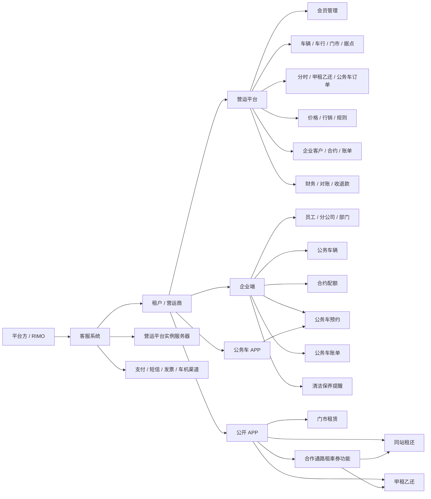
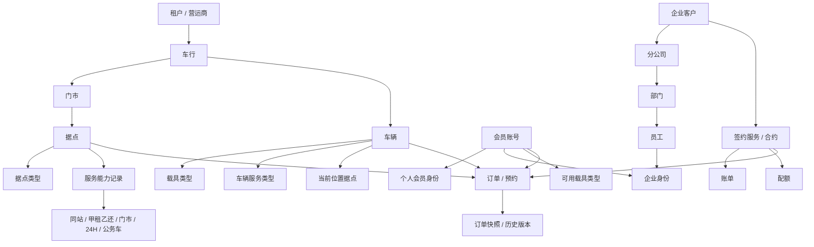
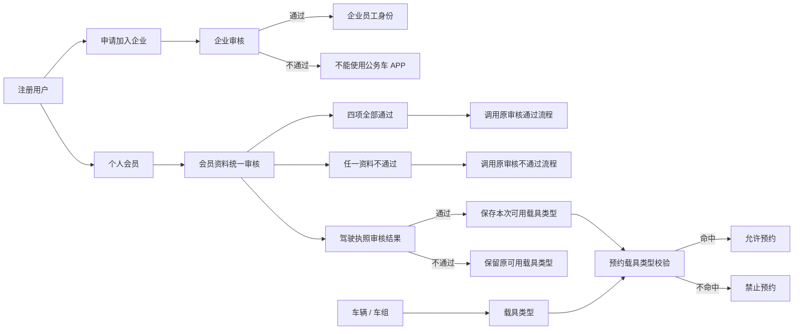
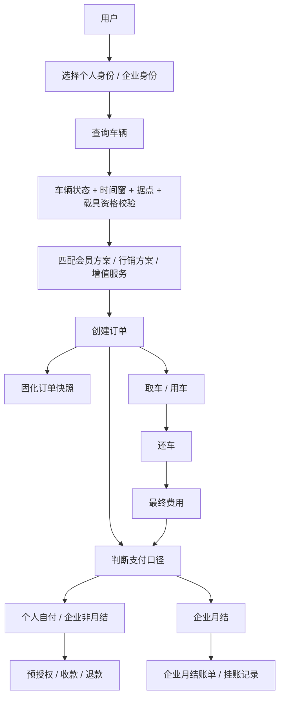
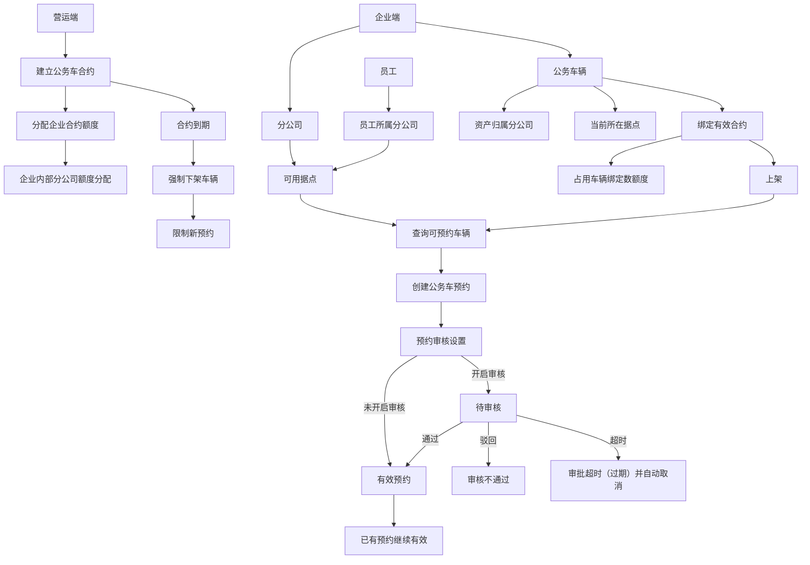
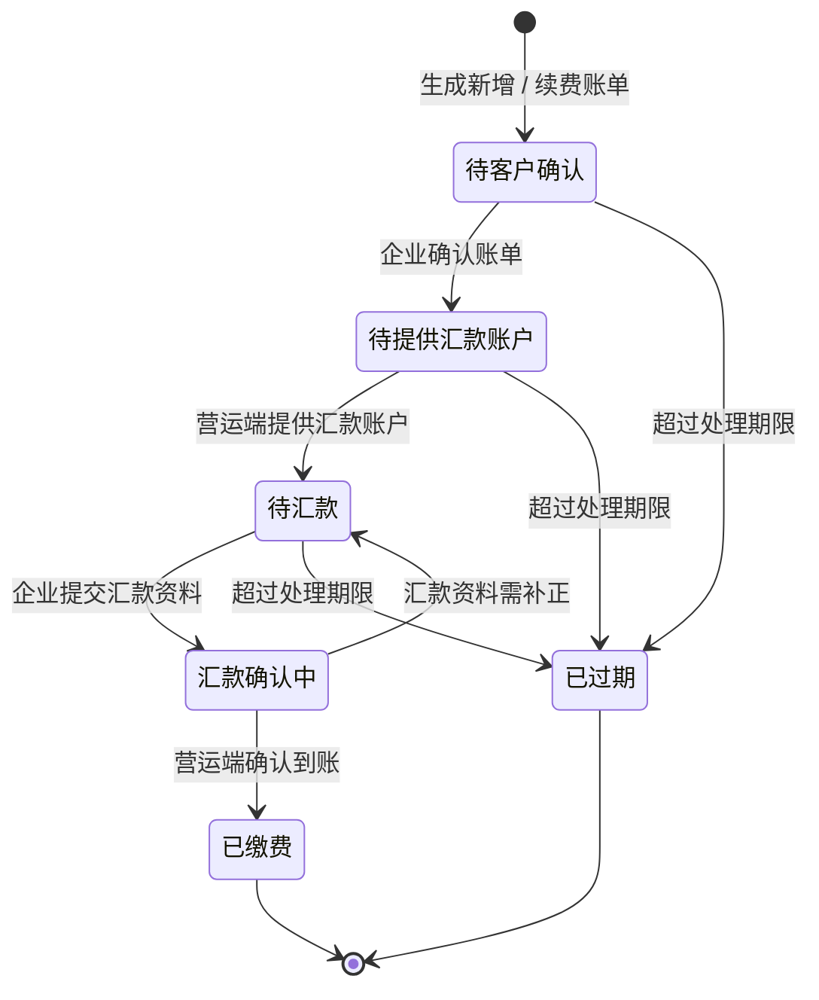
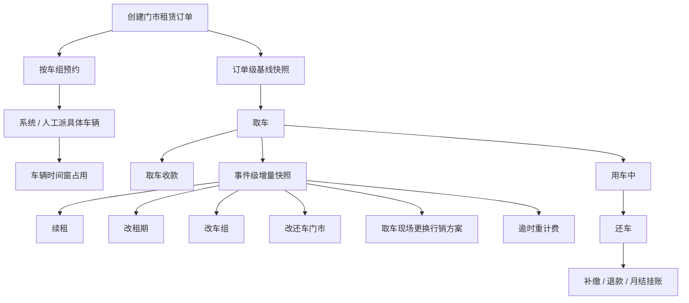
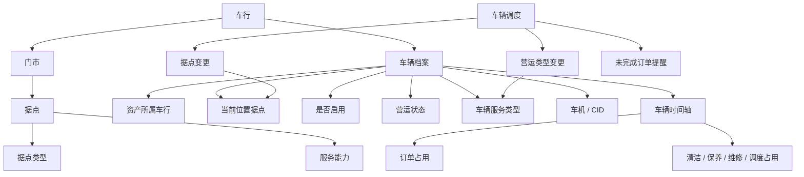
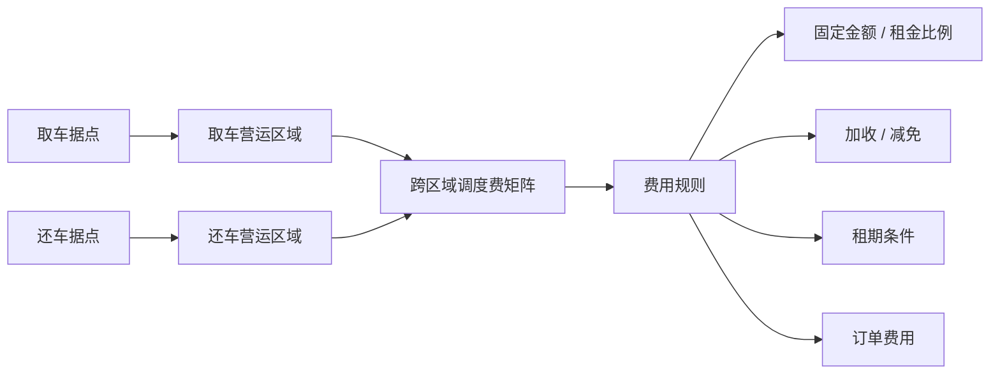

# RIMO 租赁平台功能业务关系图表

## 版本更新记录

| 版本 | 日期 | 更新内容 |
| --- | --- | --- |
| v1.2 | 2026-08-12 | 同步服务据点双视图、车行与门市独立管理、服务模式权限和会员审核兼容规则；明确合作通路租車券为分时租赁跨模式功能，并将外部源码关系标记为历史快照。 |
| v1.1 | 2026-06-30 | 补充营运端源码深读结果，增加车辆状态 / 调度 / 时间窗、车行门市据点、甲租乙还区域费用和系统规则之间的主业务关系。 |
| v1.0 | 2026-06-30 | 根据现有业务知识库、营运端前端源码、企业端前端源码和最新业务确认，建立平台级功能、对象和业务关系图表。 |

## 1. 文档定位

本文用于用图表方式说明 RIMO Rental 的系统关系、业务线关系、核心对象关系和关键流程边界。本文适合给后续 AI、产品、开发、测试快速建立平台全貌。

本文中标记为“2026-06-30 外部源码快照”的内容，只表示当时从外部工程读取到的前端关系，不代表当前生产版本。当前实现必须回到实际工程和运行环境核对。

详细功能说明见：

- `01_业务知识库/RIMO租赁平台业务全局说明.md`
- `01_业务知识库/RIMO租赁平台功能模块清单.md`
- `01_业务知识库/分时租赁业务说明.md`
- `01_业务知识库/门市租赁业务说明.md`
- `01_业务知识库/公务车业务说明.md`

## 2. 系统与客户端关系图

## 3. 业务线与客户端矩阵

| 业务线 / 能力 | 客服系统 | 营运平台 | 企业端 | 公开 APP | 公务车 APP |
| --- | --- | --- | --- | --- | --- |
| 租户与实例 | 授权、实例、渠道 | 使用授权结果 | 不涉及 | 不涉及 | 不涉及 |
| 同站租还 | 授权业务线 | 订单、车辆、价格、行销、规则 | 企业月结查看 | 预约、取还车 | 不涉及 |
| 甲租乙还 | 授权业务线 | 订单、车辆、区域、停车、调度费 | 企业月结查看 | 预约、取还车 | 不涉及 |
| 门市租车 | 授权业务线 | 订单、门市、车组、派车、规则 | 月结订单查看 | 下单 / 查询 | 不涉及 |
| 24 小时自助租车 | 授权业务线 | 订单、车组、车机、规则 | 月结订单查看 | 自助取还车 | 不涉及 |
| 合作通路租車券（分时租赁功能） | 企业 / 合作通路资料 | 批次、名单 / 数量、租車券、兑换码、订单核对；当前一期仅同站租还 | 合作通路企业只读查看 | 账户内租車券预约 / 兑换码领取 | 不涉及 |
| 公务车 | 授权企业公务车服务 | 企业、合约、配额、账单、车辆查看 | 车辆、员工、分公司、预约、账单 | 不涉及 | 员工预约用车 |

## 4. 核心业务对象关系图

## 5. 会员、企业身份与载具资格关系

口径说明：

- 会员审核开关只控制注册和资料修改是否需要人工审核，不直接放行载具类型。
- 四项资料默认选中通过；四项全通过调用原通过流程，任意一项不通过调用原不通过流程，以兼容原后端。
- 驾驶执照通过时保存本次选择的可用载具类型，即使其他资料项不通过；只有驾驶执照不通过时保留原值。
- 微电车不要求驾驶执照和驾驶执照资料上传，但该能力尚未实现。
- 公务车使用企业员工身份，公开租赁使用个人会员或企业身份。

## 6. 分时租赁订单与资金关系

## 7. 公务车合约、车辆与预约关系

口径说明：

- 公务车额度是车辆绑定数，不是预约次数。
- 车辆资产归属决定车辆管理权限和合约绑定。
- 预约归属按员工所属分公司判断。
- 合约到期、车辆下架或调拨不自动取消已有预约。

## 8. 公务车账单状态关系

## 9. 门市租赁资源与快照关系

## 10. 据点、组织与服务能力关系

| 对象 | 已确认产品模型 | 实施要求 |
| --- | --- | --- |
| 车行 | 独立页面维护，作为车辆资产归属、同车行调度、经营归集和数据范围 | 车行账号只处理本车行数据；当前车行结算仍在线下 |
| 门市 | 独立页面维护，归属一个车行，承载客户服务、营业时间和店员履约 | 门市账号只处理本门市；所属车行创建后不得变更 |
| 据点 | 一个实体据点一条基础资料，可具备多种服务能力 | 据点总览一行一个据点；基础据点停用后全部服务模式停止接受新业务 |
| 服务能力 | 一个“据点 + 服务模式”一条能力记录，同一组合不得重复 | 服务能力管理一行一条能力；单项暂停只影响对应模式 |
| 据点权限 | 数据范围 + 功能权限 + 服务模式权限 | 据点总览与各模式查看 / 维护分别控制，后端过滤后再返回数据 |
| 据点车位 | 据点总车位是物理容量 | 各服务能力预留车位之和不得超过总车位 |
| 车辆服务类型 | 当前单选，同一时间只属于一个业务线或服务类型 | 未来统一排程中心再支持跨业务线时间窗占用 |
| 公务车据点 | 平台授权据点或企业自建据点，不参与公开租赁据点选择 | 与平台据点底座统一，按服务能力和来源隔离 |
| 门市租赁据点 | 门市租车按门市汇总可交付库存，24 小时自助租车面向具体据点 | 门市租车与 24 小时自助分别配置服务能力 |

## 11. 2026-06-30 外部源码快照关系

本节用于保留当时外部营运端前端源码中可确认的关系，只作为历史实现快照；页面、接口和生产状态发生变化时，以实际工程为准。

### 11.1 车辆、据点与调度关系

口径说明：

- 车辆资产所属车行用于资产归属、数据范围和车行结算归属，不因车辆当前位置变化而改变。
- 车辆服务类型当前按单选处理；服务类型变更通过调度流程处理。
- 车辆是否启用、营运状态和时间窗占用共同决定车辆是否可预约、可派车或可发车。
- 调度前需要提示车辆未完成订单，避免调度影响既有订单履约。

### 11.2 甲租乙还区域与调度费关系

口径说明：

- 甲租乙还调度费按营运区域之间配置，不按单个据点之间一对一配置。
- 调度费支持加收或减免，费用类型支持固定金额或按租金比例。
- 甲租乙还可还车据点仍必须同时判断据点服务能力、启用状态和空闲车位。

### 11.3 规则配置与订单执行关系

| 配置对象 | 影响业务 | 订单创建后处理 |
| --- | --- | --- |
| 标准价 | 计算基础租金 | 订单保存价格快照 |
| 行销方案 | 影响租金优惠、适用会员方案、适用时间和车辆范围 | 订单保存使用的行销方案快照 |
| 优惠券 / 优惠码 | 影响个人订单抵扣 | 订单保存抵扣记录和使用状态 |
| 会员方案 | 影响可见车辆、可用行销方案、甲租乙还订单有效期和取消限制 | 订单保存会员方案快照 |
| 租赁业务规则 | 影响取消、预授权、逾时、提前还车、订单间隔和门市派车规则 | 订单保存规则版本 |
| 车辆服务类型 | 决定车辆参与哪类业务候选池 | 服务类型变更不反向影响历史订单 |
| 据点服务能力 / 据点类型 | 决定用户侧可选择的服务入口和取还车点 | 据点关闭不自动取消已创建订单 |
| 收费项目 | 决定费用归类、开票和财务核对口径 | 费用明细保存收费项目和金额 |

## 12. 当前业务关系检查表

| 新需求影响点 | 必查对象 |
| --- | --- |
| 是否新增业务线 | 客服系统授权、租户业务线、订单编号前缀、菜单权限、APP 入口 |
| 是否影响车辆预约 | 车辆服务类型、所在据点、营运状态、时间窗占用、载具类型、会员资格 |
| 是否影响企业身份 | 企业月结 / 非月结、企业方案、员工关系、账单归属 |
| 是否影响公务车 | 合约额度、车辆绑定、分公司可用据点、员工所属分公司、预约审核、账单 |
| 是否影响资金 | 预授权、收款、退款、企业挂账、企业月结、公务车合约账单 |
| 是否影响历史 | 订单快照、合约快照、账单快照、操作记录、配置版本 |
| 是否影响通知 | 通知对象、通知渠道、触发时点、失败处理、操作记录 |
| 是否影响权限 | 菜单权限、操作权限、总公司 / 分公司管理员、营运角色、财务角色 |
